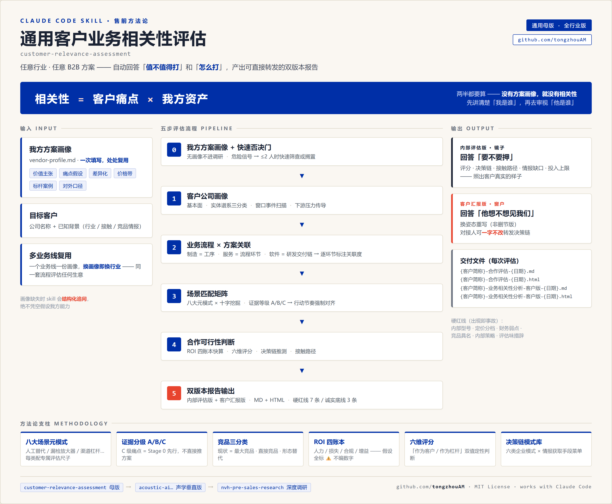

# 通用客户业务相关性评估 Skill（全行业版）

> 你提供**自己的方案画像** + 目标客户名称 → 输出业务相关性判断 + 场景匹配 + 行动方案 + 双版本报告。
> 不绑定任何行业：声学检测、工业软件、SaaS、设备、专业服务……任何 B2B 方案都能用。

一个 [Claude Code](https://claude.com/claude-code) Skill（同样适用于其他支持 SKILL.md 规范的 Agent 工具）。



---

## 逻辑链

```
第零步A  我方方案画像（你的产品/痛点假设/价格带/案例/对外口径 —— 一次填写，处处复用）
第零步B  内部档案核对 + 快速否决门
第一步   客户公司画像（基本面/实体谱系/时间线/窗口事件/下游压力）
第二步   客户业务流程拆解 × 我方方案关联分析（制造=工序 / 服务=流程 / 软件=研发交付链）
第三步   场景匹配（八大元模式 × 十字挖掘法 → 场景矩阵含证据等级 A/B/C）
第四步   可行性判断（六维评分 + 决策链推测 + 接触路径）
第五步   双版本报告（内部评估版 + 客户汇报版）
```

核心机制：

- **相关性 = 客户痛点 × 我方资产**：方案画像先行，没有画像不进入调研——避免"对着客户硬造相关性"
- **八大场景元模式**：人工替代 / 资产健康 / 漏检放大器 / 过程防错 / 初筛互补 / 渠道杠杆 / 同业协同 / 标准源头——每类配专属评估尺子，用错尺子是场景误判的头号原因
- **证据等级 A/B/C 强制对齐行动节奏**：C 级痛点 = Stage 0 先行，不直接推方案
- **竞品三分类**：现状（最大竞品）/ 直接竞品 / 形态替代——多数评估死在没算清"客户凭什么忍受现状"
- **ROI 四账本**：人力替代 / 损失避免 / 合规审核 / 收入增益，所有假设标 ⚠️，不编基准数字
- **双版本转化规则**：内置硬红线 7 条 + 诚实底线 3 条，客户版是换姿态重写而非删节

## 适用人群

- 任何 B2B 方案商的销售/售前/渠道团队（制造业、软件、专业服务均适用）
- 需要结构化"这个客户值不值得打"方法论的独立顾问/自由销售
- 想给多个业务线各配一套客户评估的创业者（一个业务线一份 vendor-profile）

---

## 安装方法

```bash
# macOS / Linux
git clone https://github.com/tongzhouAM/customer-relevance-assessment.git \
  ~/.claude/skills/customer-relevance-assessment

# Windows (Git Bash)
git clone https://github.com/tongzhouAM/customer-relevance-assessment.git \
  "/c/Users/$USERNAME/.claude/skills/customer-relevance-assessment"
```

安装后目录结构：

```
.claude/skills/customer-relevance-assessment/
├── SKILL.md                          ← 通用评估方法论（五步流程）
├── README.md                         ← 本文件
├── VERSION                           ← 版本信息
├── LICENSE                           ← MIT
├── vendor-profile-template.md        ← 我方方案画像填写模板（先填这个！）
├── vendor-profile.md                 ← （你预填后生成）当前业务的方案画像
├── references/
│   ├── scenario-mining.md            ← 通用场景挖掘方法论（八大元模式+十字挖掘法）
│   ├── competitor-research.md        ← 通用竞品研究框架（三类竞品+档案卡+拆招）
│   ├── roi-benchmarks.md             ← 通用 ROI 四账本框架+基准查证路径
│   ├── decision-patterns.md          ← 企业类型 → 决策链模式
│   └── dual-version-rules.md         ← 双版本产出规则（硬红线+诚实底线）
└── templates/
    ├── assessment-report-template.md   ← Markdown 报告模板
    └── assessment-report-template.html ← HTML 网页报告模板
```

**首次使用**：把 `vendor-profile-template.md` 复制为 `vendor-profile.md` 填好（或直接在对话里说清你的方案）。

## 使用方法

```
帮我评估一下 {客户名称}，和我们的方案相关性如何
分析一下 {某公司}，能不能打——我的方案画像是：{一段描述，或已预填 vendor-profile.md}
```

触发关键词：客户评估 · 合作可行性 · 客户分析 · 打单评估 · 业务相关性 · 能不能打 · 值不值得跟

---

## 输出产物

每次评估产出 **两份文件**（保存到用户指定目录，未指定时 Claude 会先询问）：

| 文件 | 用途 |
|------|------|
| **内部评估版** `{客户简称}-合作评估-{日期}.md/.html` | 评分、决策链、接触路径、情报缺口、投入上限 |
| **客户汇报版** `{客户简称}-业务相关性分析-客户版-{日期}.md/.html` | 换姿态重写的说服材料，对接人可一字不改转发决策链 |

---

## 与垂直 skill 的关系

本 skill 是**通用母版**。行业垂直 skill（预置领域知识库/场景库/竞品库）与它串联使用：

| skill | 定位 |
|-------|------|
| **本 skill** | 通用流程：任意 B2B 方案 × 任意客户 |
| [acoustic-ai-customer-assessment](https://github.com/tongzhouAM/acoustic-ai-customer-assessment) | 声学检测行业垂直版（16 场景库 + 声学竞品库 + 方案组件） |
| [nvh-pre-sales-research](https://github.com/tongzhouAM/nvh-pre-sales-research) | NVH 异音深度技术调研（79 零部件×9 维度领域知识库） |

串联：本 skill 筛选客户 → 垂直 skill 做行业深度。**垂直化的正确姿势**：领域知识写进 references，流程保持与母版一致。

---

## 注意事项

1. **评估结果基于公开信息**：所有分析来自互联网公开数据，部分结论需实地验证
2. **不编基准数字**：ROI 基准查不到就标"待验证"，用本框架的查证路径找数据
3. **招聘信息只用于推断，不直接展示**
4. **方案画像定期更新**：产品迭代/价格调整后同步更新 `vendor-profile.md`

---

## 版本

**v1.0.0** · 2026-11-17

作者：tongzhouAM · MIT License
